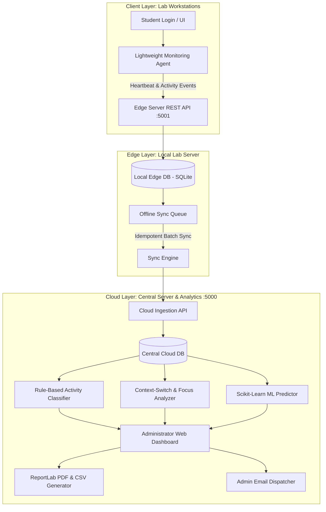

# CloudLab Intelligence: An Offline-First Edge-Cloud Platform for Student Digital Activity Analytics and Predictive Computer Lab Resource Optimization

**Department of Information Technology**  
**Sona College of Technology (Autonomous Institution)**  
**Mini Project – U23IT705 (Academic Year 2026-27)**  

**Batch No:** 10  
**Project Team:**
- **Jayakumar M** (Reg No: 61782323106044) — *Lead: Authentication & Session*
- **Neha Prapti P** (Reg No: 61782323106072) — *Lead: Monitoring & Logging*
- **Prabanjan V** (Reg No: 61782323106077) — *Lead: Edge Server & Sync*

**Mentor / Guide:** Mr. P. Dineshkumar, AP / IT  

---

## 📖 Project Overview

College computer laboratories often lack a unified system to accurately monitor student sessions, computer utilization, application usage, browser activity, and resource requirements. Existing cloud-dependent systems also become unavailable during internet outages, causing data loss.

**CloudLab Intelligence** solves these problems using a **Hybrid Edge-Cloud Architecture**:
1. **Client Layer**: Students authenticate using their college Register Numbers. A lightweight, privacy-first monitoring agent captures active application usage, browser tabs/domains, tab-switching events, and active vs. idle duration (zero keylogging).
2. **Edge Layer (Local Edge Server on Port 5001)**: Buffers all student events locally in an offline SQLite database and queue. Continues 100% uninterrupted logging during campus internet outages.
3. **Idempotent Data Synchronization**: Automatically batch-uploads queued events to the Cloud API once internet is restored, using SHA-256 idempotency hashing to prevent duplicate records.
4. **Cloud Analytics & ML Optimization (Port 5000)**: 
   - **Rule-Based Activity Classification**: Categorizes activities into *Programming*, *Database*, *Research & Learning*, *Documentation*, and *Off-Task*.
   - **Context-Switch Analysis**: Measures app/tab transitions and computes a real-time **Focus Score (0 - 100%)**.
   - **Predictive ML Resource Optimization**: Uses Scikit-Learn **Random Forest Regression** to forecast hourly lab demand, peak concurrency, and recommend power-saving standby modes.
5. **Administrator Dashboard & Reporting**:
   - **Live Lab Grid**: Real-time visual status of 24 lab workstations with active student details, current app, and browser tab.
   - **Student Activity Directory**: Searchable directory with login/logout timestamps, duration, focus rating, and tab counts.
   - **PDF & CSV Generator**: Generates official institution-branded PDF reports via ReportLab.
   - **Administrator Email Dispatcher**: Dispatches session audit reports directly to the administrator with audit logs.

---

## 🏛️ System Architecture



---

## 🚀 Quick Start Guide

### 1. Installation
Install the required dependencies:
```bash
pip install -r requirements.txt
```

### 2. Launch the Entire Platform
Run the master launcher:
```bash
python run_system.py
```
This automatically:
- Initializes the Edge (`edge_storage.db`) and Cloud (`cloud_storage.db`) databases.
- Seeds the initial student records (Batch 10 team & peers) and 24 workstations.
- Trains the Scikit-Learn Random Forest lab demand forecasting model.
- Launches the **Local Edge Server** on `http://127.0.0.1:5001`.
- Launches the **Central Cloud & Admin Dashboard** on `http://127.0.0.1:5000`.
- Opens the web dashboard in your default browser.

### 3. Run Automated Unit Tests
```bash
python tests/test_system.py
```

---

## 🖥️ Dashboard Features

| Tab | Feature | Description |
|---|---|---|
| **1. Live Lab Monitor** | 🖥️ Real-time Workstation Grid | Live visual grid of 24 workstations displaying active students, current app, browser tab, session timer, and focus score. |
| **2. Student Reports & Tabs** | 📊 Detailed Activity Directory | Searchable student table, drill-down modal with category pie charts, visited browser domains, and one-click PDF download. |
| **3. Predictive ML Optimization** | 🤖 Resource Demand Forecasting | Hourly lab occupancy predictions and AI recommendations for energy conservation and capacity planning. |
| **4. Edge-Cloud Sync Engine** | ⚡ Offline-First Queue & Outage Simulator | Simulate network outages to test offline queue buffering and trigger idempotent cloud sync with audit hashes. |
| **5. Admin PDF & Dispatch** | 📤 Report Dispatching | Generate official PDF reports and dispatch digital summaries directly to administrator email (`admin.it@sonatech.ac.in`). |
| **6. Student Workstation Portal** | 🎓 Student Client Interface | Student login by Register Number, session timer, and live active window simulator. |

---

## 📄 Privacy-First Policy
The CloudLab Intelligence agent strictly captures **process names, window titles, browser domains, and timestamps**. It performs **zero keylogging, zero keystroke inspection, and zero screen recording**, ensuring complete student privacy compliance.
